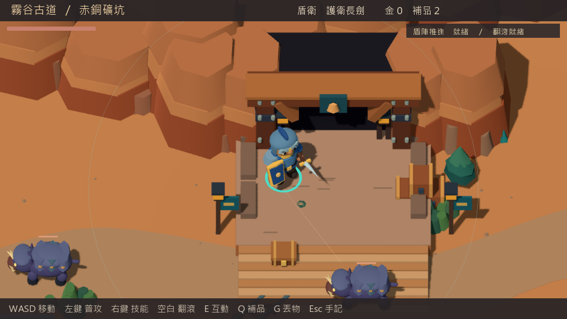

# 霧谷古道

**第一章・斷鏈之獸**　｜　繁體中文　｜　Windows 64 位元

[直接下載安裝檔](https://github.com/SKYMOPK/mistvale-old-road/releases/latest/download/Mistvale-Setup.exe) · [版本與更新紀錄](https://github.com/SKYMOPK/mistvale-old-road/releases)

六個區域由 Godot 原生立體地形、岩石、建築、軌道與機關構成。斜俯視鏡頭會跟隨玩家。四職、商人、巡邏獸與首領皆由 Godot 原生 3D 網格建模。選角可預覽實際模型，戰鬥時武器與肢體會隨動作轉動。

從山麓驛站出發，在斷橋山道選擇穿越赤銅礦坑或風蝕棧道。抵達哨所後可以折返另一條路。在吊橋機關庭擊倒斷鏈披甲獸，再到東側絞盤親手放下吊橋，開通返回驛站的捷徑。

## 進入古道

執行安裝程式後，從 Windows 開始功能表開啟「霧谷古道」。啟動器會檢查本頁最新版本，下載遊戲檔並核對 SHA-256。已有安裝時也能離線啟動。六個命名存檔槽與設定保存在使用者的 Godot 資料目錄。

| 操作 | 按鍵 |
| --- | --- |
| 移動與手動瞄準 | WASD、滑鼠 |
| 普攻、職業技能 | 滑鼠左鍵、右鍵 |
| 翻滾、取消普攻 | 空白鍵 |
| 開箱、購買補給、出口確認、操作機關 | E |
| 扶起倒地隊友 | 近身按住 E 兩秒 |
| 使用補品、放下最近取得的武器 | Q、G |
| 倒地自行回營、開啟手記 | R、Esc |

盾衛以劍盾護隊，槍客以槍刃尖端突刺並鎖定狙擊，遊俠蓄弓並召喚精靈，燈術師以燈火點燃敵人並治療隊友。隊友可選相同職業，角色在同一世界的本章進度中鎖職。

## 同行房間

房主選「建立同行房間」，在手記查看房間碼。區網玩家直接輸入房間碼。房主保存世界與同行者的裝備金幣；重連請使用原本的裝置與存檔槽。

跨網路可使用可達的 UDP 31974 位址，或由房主在設定填入已部署的中繼主機後開房，分享以 `R:` 開頭的完整房間碼。自架中繼需要 Python 3，執行 [server.py](relay/server.py) 並開放 UDP 31975。本專案目前未附公共中繼站。四人的驗收環境為同一台 Windows 電腦上的獨立遊戲程序與 UDP 中繼。

遊戲使用 Godot Engine。[Godot 與第三方元件授權](https://godotengine.org/license/)

